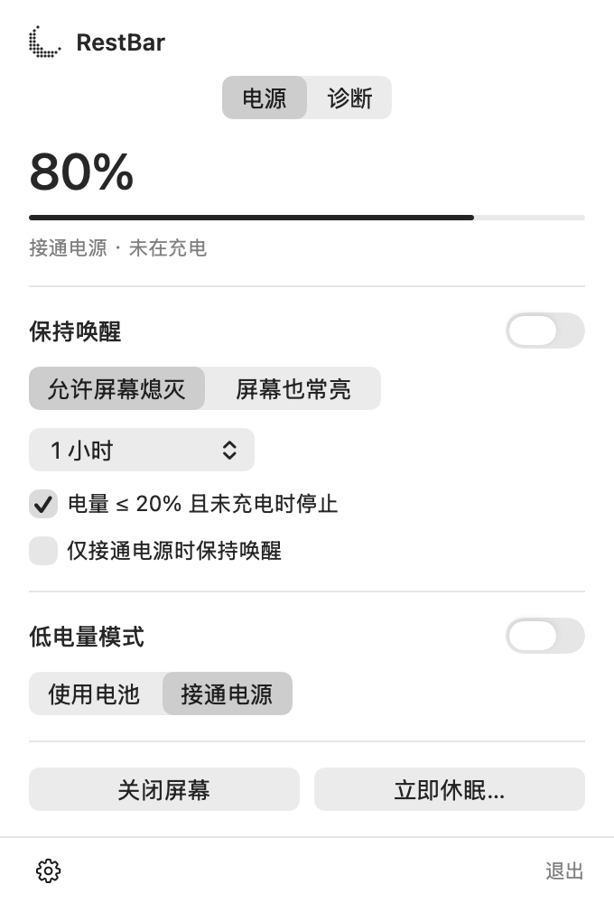
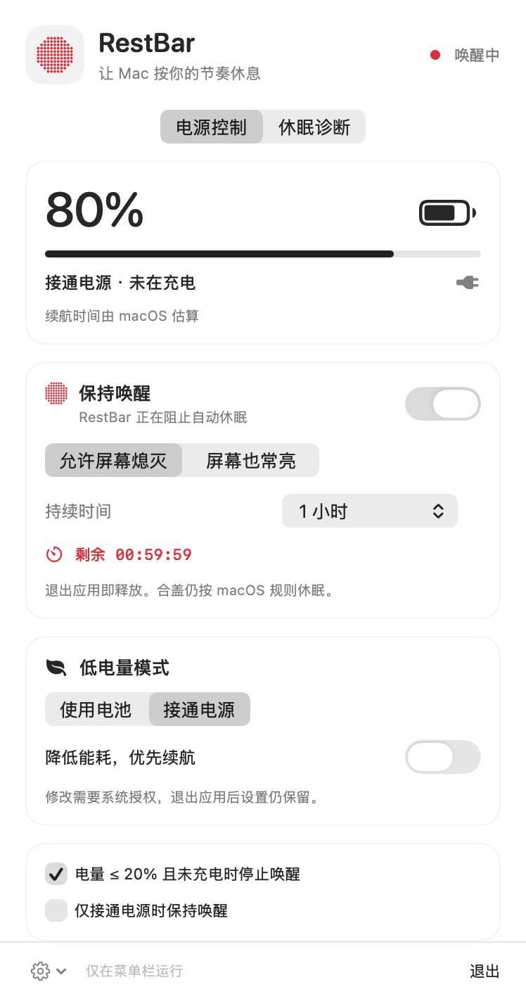

<p align="center">
  <picture>
    <source media="(prefers-color-scheme: dark)" srcset="assets/brand/lockup-on-dark.png">
    
  </picture>
</p>

<p align="center"><strong>Let your Mac rest on your schedule.</strong></p>

<p align="center"><a href="README.zh-CN.md">中文说明</a></p>

RestBar is a small native menu bar app for macOS. It keeps your Mac awake for as long as you choose and stops on its own: when the time is up, when you unplug, or when the battery runs low. It also shows what is stopping your Mac from sleeping, and manages Low Power Mode.

No account, no network access, no telemetry, no third-party dependencies. The whole app is under 900 lines of Swift you can read in an afternoon.

| At rest | Awake |
| --- | --- |
| <picture><source media="(prefers-color-scheme: dark)" srcset="assets/screenshots/panel-resting-dark.png"></picture> | <picture><source media="(prefers-color-scheme: dark)" srcset="assets/screenshots/panel-awake-dark.png"></picture> |

The interface is in Simplified Chinese today. English is [planned](https://github.com/Noxr3/RestBar/issues).

## What it does

- **Keeps your Mac awake**, with the display allowed to sleep or kept on too.
- **Stops by itself** after 15 or 30 minutes, 1, 2 or 4 hours, or only when you turn it off.
- **Protects your battery:** optionally stops when you unplug, or at 20% when not charging.
- **Shows what is keeping your Mac up:** the apps preventing sleep and the system's sleep policy.
- **Manages Low Power Mode** separately for battery and for external power.
- **Turns the display off** or puts the Mac to sleep, with a confirmation.
- **Optionally starts at login** and shows the battery percentage in the menu bar.

## Install

There is no notarized download yet, so for now you build it yourself. You need an Apple Silicon Mac on macOS 13 or later, and Xcode or the Command Line Tools.

```sh
git clone https://github.com/Noxr3/RestBar.git
cd RestBar
bash build.sh
open dist/RestBar.app
```

To keep it, drag `dist/RestBar.app` into `~/Applications` or `/Applications`, and quit any running copy first. Click the moon in the menu bar to open the panel; right-click for quick actions.

### Can't see the icon?

RestBar has no window. If your menu bar is full, macOS hides new icons behind the notch without telling you, so RestBar can be running with nothing to click. Hold ⌘ and drag other menu bar icons to make room, or quit one you don't need.

## What to expect

- **Starting RestBar changes nothing.** Keep-awake is off until you turn it on.
- **Keep-awake cannot outlive the app.** It uses a temporary macOS power assertion that is released when the time runs out or the app exits, even if the app crashes. Closing the panel leaves a session running.
- **Closing the lid and choosing Sleep still work** the way macOS normally does.
- **RestBar only releases its own request.** Other apps may still be keeping your Mac awake; the diagnostics tab shows them.
- **Low Power Mode and restoring a disabled sleep policy are lasting system settings.** Changing them shows the native macOS administrator prompt, and they stay changed after RestBar quits. RestBar never reads or stores your password.
- **Not included:** charge limits, fan control and whole-machine wattage.

## Project status

RestBar is early. The automated checks pass, but these still need a person to try them on each macOS version: administrator changes, immediate sleep, display sleep and start at login. Builds are ad-hoc signed and made for Apple Silicon only, so a copy moved to another Mac may not open normally. Intel has not been tried.

## Develop

```sh
bash test.sh                 # 33 deterministic parsing, policy and mark checks
bash test.sh --integration   # Adds 8 checks against the real power APIs
```

The integration checks briefly create and release real keep-awake assertions. They never put the Mac to sleep or change Low Power Mode. Run one at a time, on a local Mac. CI runs the deterministic checks, builds and validates the app, and uploads a zipped build; it cannot run the hardware or password-prompt flows.

| Path | Purpose |
| --- | --- |
| `Sources/PowerCore.swift` | Battery APIs, settings parsers, policies, power assertions |
| `Sources/PowerController.swift` | Session lifecycle, system settings, authorization, login item |
| `Sources/Panel.swift` | The menu bar panel |
| `Sources/AppDelegate.swift` | Status item and app lifecycle |
| `Sources/Brand.swift` | Colours and the dot-matrix moon, drawn by the app and the icon alike |
| `Tests/main.swift` | Deterministic and local integration checks |
| `scripts/Icon.swift` | Generates the app icon and brand images |
| `scripts/PanelShot.swift` | Renders the README screenshots from the real panel |

See [CONTRIBUTING.md](CONTRIBUTING.md) to get involved, [SECURITY.md](SECURITY.md) to report a vulnerability, and [docs/BRAND.md](docs/BRAND.md) for how RestBar should look and sound.

## License

[MIT](LICENSE)
