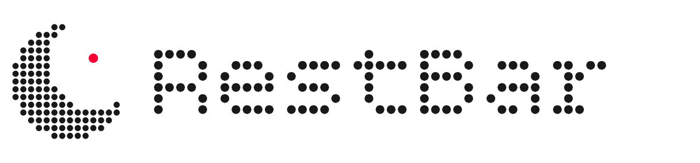
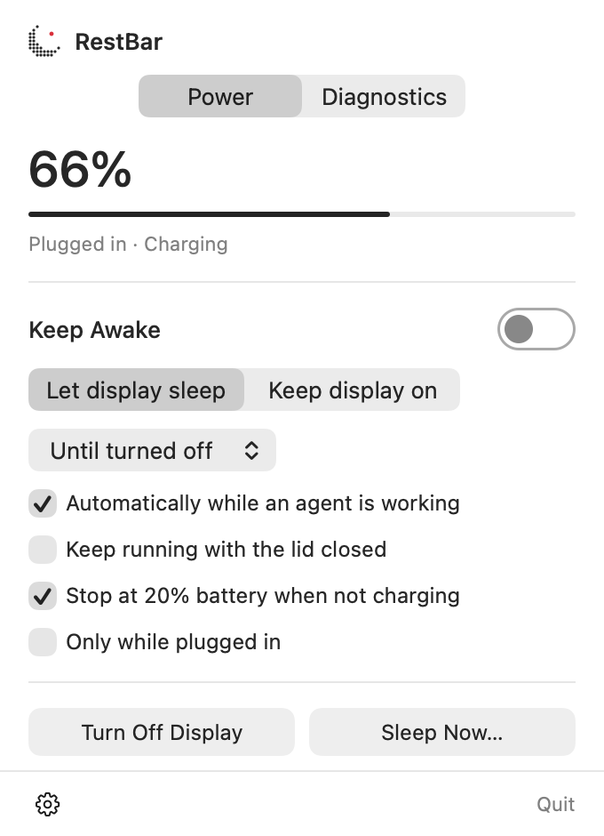
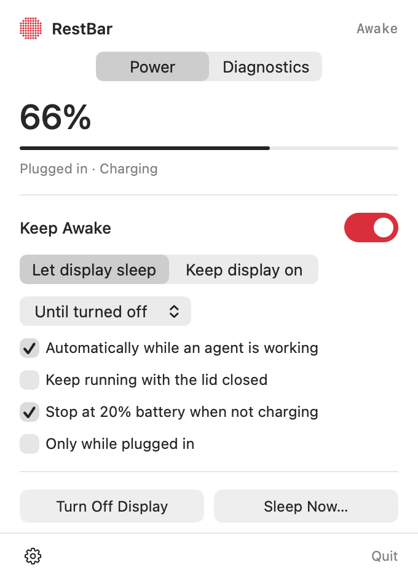

<p align="center">
  <picture>
    <source media="(prefers-color-scheme: dark)" srcset="assets/brand/lockup-on-dark.png">
    
  </picture>
</p>

<p align="center"><strong>Keep your Mac awake while your agents work.</strong></p>

<p align="center"><a href="README.zh-CN.md">中文说明</a></p>

You start Claude Code or Codex on a long task, walk away, and your Mac goes to sleep halfway through. RestBar is a small native menu bar app that stops that. It sees when an agent is working and keeps your Mac awake, even with the lid closed, then lets it sleep again when the work is done.

```sh
brew install --cask noxr3/tap/restbar
```

No account, no network access, no telemetry, no third-party dependencies. The whole app is about 1,300 lines of Swift you can read in an afternoon.

| At rest | Awake |
| --- | --- |
| <picture><source media="(prefers-color-scheme: dark)" srcset="assets/screenshots/en/panel-resting-dark.png"></picture> | <picture><source media="(prefers-color-scheme: dark)" srcset="assets/screenshots/en/panel-awake-dark.png"></picture> |

RestBar follows your system language: English, Simplified Chinese or Traditional Chinese. Any other language falls back to English.

## What it does

- **Follows your agents.** Claude Code, Codex, Gemini CLI, Aider, Cursor's agent, OpenCode, Goose, Amp, Droid, Crush, Cline and Qwen Code. An agent counts as working while it or anything it started is using the CPU, and for ten minutes after that, because an agent waiting on its model looks idle. An open session that's doing nothing doesn't keep your Mac up.
- **Keeps going with the lid closed**, if you turn that on.
- **Stops by itself:** at 20% battery if you choose, when you unplug if you choose, and when a timer you set runs out.
- **Shows what's keeping your Mac up:** agents, other apps and the system's sleep policy.
- **Also does the basics:** keep awake by hand, keep the display on, turn the display off, sleep now, and Low Power Mode from the gear menu.

## Install

**Homebrew**

```sh
brew install --cask noxr3/tap/restbar
```

**One line in Terminal**

```sh
curl -fsSL https://raw.githubusercontent.com/Noxr3/RestBar/main/install.sh | bash
```

It checks the download's checksum and signature, and that Apple notarized it. [Read it first](install.sh) if you like.

**Download**

Get `RestBar.dmg` from [the latest release](https://github.com/Noxr3/RestBar/releases/latest), open it, and drag RestBar to Applications.

**From source**

```sh
git clone https://github.com/Noxr3/RestBar.git
cd RestBar
bash build.sh
open dist/RestBar.app
```

You need macOS 13 or later. Builds are universal, for Apple Silicon and Intel. Click the moon in the menu bar to open the panel; right-click for quick actions.

### Can't see the icon?

RestBar has no window. If your menu bar is full, macOS hides new icons behind the notch without telling you, so RestBar can be running with nothing to click. Hold ⌘ and drag other menu bar icons to make room, or quit one you don't need.

## What to expect

- **Keep-awake uses a temporary macOS power request** that is released when the time runs out or the app exits, even if the app crashes. Closing the panel leaves a session running.
- **RestBar starts at login by default.** The first time you open it from an Applications folder it adds itself to your login items, and macOS tells you. Turn it off under the gear menu, and it stays off.
- **RestBar only releases its own request.** Other apps may still be keeping your Mac awake; the diagnostics tab shows them.
- **Not included:** charge limits, fan control and whole-machine wattage.

### With the lid closed

macOS sleeps when the lid closes no matter what an app asks for, so this takes a system setting, `pmset disablesleep`. It's off until you turn it on. Here is exactly what happens:

- **The first time,** macOS asks for your password once, to install `/etc/sudoers.d/restbar`. That file lets your account run only `pmset -a disablesleep 0` and `pmset -a disablesleep 1` without a password, so RestBar can switch sleep back on when you aren't there to type one. Remove it any time from the gear menu.
- **Sleep comes back** when keep-awake stops, when the app quits, and if the app crashes or is force quit, through a small watcher process that lasts only as long as the session. After a restart, RestBar restores it when it next starts.
- **It stops itself** at 20% battery and when macOS reports your Mac is running hot, whatever your other options say. Don't put a running Mac in a bag. A closed laptop has less airflow and nothing will tell you it's warm.

## Agent detection

RestBar reads the process list every ten seconds: process names, the script an interpreter is running, and CPU use. It stores none of it and sends it nowhere. It's a heuristic. An agent that sits silent for over ten minutes counts as finished, and an agent RestBar doesn't know about isn't noticed. To add one, see `AgentDetector` in `Sources/AgentWatch.swift`.

## Project status

RestBar is early. The automated checks pass, but these still need a person to try them on each macOS version: running with the lid closed, administrator changes, immediate sleep, display sleep and start at login. Intel builds compile but haven't been tried on an Intel Mac.

## Develop

```sh
bash test.sh                 # 64 deterministic checks: parsing, policy, agents, marks, translations
bash test.sh --integration   # Adds 10 checks against the real power APIs and the watcher
```

The integration checks briefly create and release real keep-awake assertions. They never put the Mac to sleep or change Low Power Mode. Run one at a time, on a local Mac. CI runs the deterministic checks, builds and validates the app, and uploads a zipped build; it cannot run the hardware or password-prompt flows.

| Path | Purpose |
| --- | --- |
| `Sources/AgentWatch.swift` | Agent detection and the lid-closed rules |
| `Sources/PowerCore.swift` | Battery APIs, settings parsers, policies, power assertions |
| `Sources/PowerController.swift` | Session lifecycle, system settings, authorization, login item |
| `Sources/Panel.swift` | The menu bar panel |
| `Sources/AppDelegate.swift` | Status item and app lifecycle |
| `Sources/Brand.swift` | Colours and the dot-matrix moon, drawn by the app and the icon alike |
| `Resources/*.lproj/` | The translations |
| `Tests/main.swift` | Deterministic and local integration checks |
| `scripts/Icon.swift` | Generates the app icon and brand images |
| `scripts/screenshots.sh` | Renders the README screenshots from the real panel |
| `scripts/release.sh` | Signs, notarizes and packages a release |
| `install.sh`, `packaging/homebrew/` | The one-line installer and the Homebrew cask |

See [CONTRIBUTING.md](CONTRIBUTING.md) to get involved, [SECURITY.md](SECURITY.md) to report a vulnerability, and [docs/BRAND.md](docs/BRAND.md) for how RestBar should look and sound.

## License

[MIT](LICENSE)
