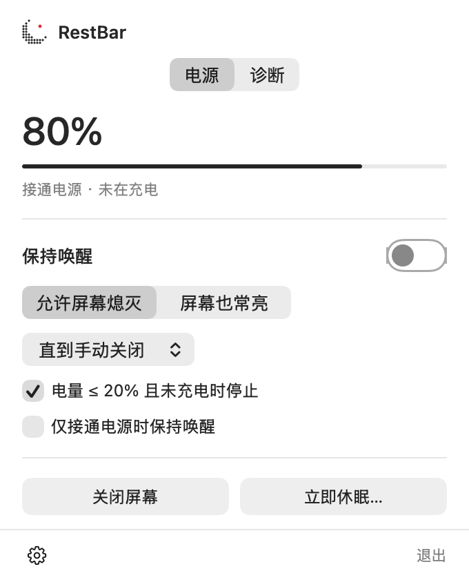
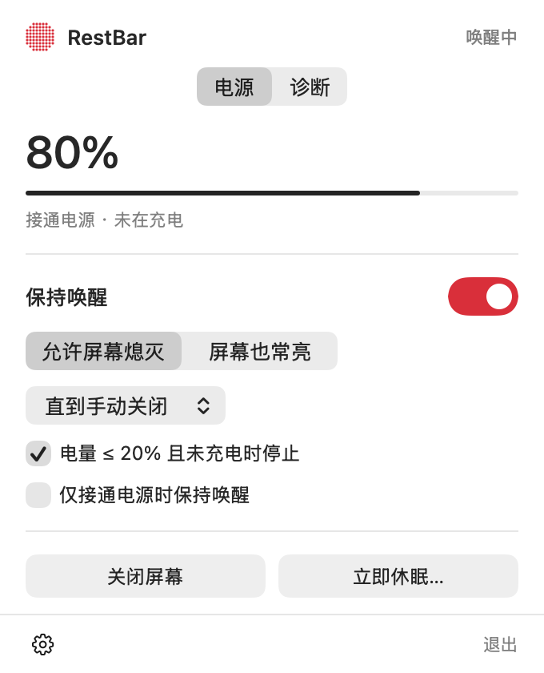

<p align="center">
  <picture>
    <source media="(prefers-color-scheme: dark)" srcset="assets/brand/lockup-on-dark.png">
    
  </picture>
</p>

<p align="center"><strong>让 Mac 按你的节奏休息</strong></p>

<p align="center"><a href="README.md">English</a></p>

RestBar 是一个原生 macOS 菜单栏小工具。它让 Mac 保持唤醒，直到你手动关闭或设定的时间结束，也可以在拔掉电源或电量偏低时自动停止。它还能告诉你是什么在阻止 Mac 休眠。

不需要账号，不联网，不收集数据，没有第三方依赖。整个应用不到 900 行 Swift，一个下午就能读完。

RestBar 跟随系统语言：英文、简体中文或繁体中文，其他语言显示英文。

| 待机 | 唤醒中 |
| --- | --- |
| <picture><source media="(prefers-color-scheme: dark)" srcset="assets/screenshots/zh-Hans/panel-resting-dark.png"></picture> | <picture><source media="(prefers-color-scheme: dark)" srcset="assets/screenshots/zh-Hans/panel-awake-dark.png"></picture> |

## 功能

- **保持唤醒**：可以让屏幕熄灭，也可以让屏幕一起常亮。
- **默认直到手动关闭**，也可以选 15 / 30 分钟、1 / 2 / 4 小时。
- **保护电池**：可选在拔掉电源、或电量不高于 20% 且未充电时停止。
- **休眠诊断**：查看阻止自动休眠的应用和系统休眠策略。
- **低电量模式**：在设置菜单里分别管理使用电池和接通电源时的设置。
- **关闭屏幕或立即休眠**，休眠前会先确认。
- **登录时启动**，可选在菜单栏显示电量。

## 安装

目前还没有经过公证的下载包，需要自己构建。需要 Apple Silicon Mac、macOS 13 或更新版本，以及 Xcode 或命令行工具。

```sh
git clone https://github.com/Noxr3/RestBar.git
cd RestBar
bash build.sh
open dist/RestBar.app
```

想长期使用，先退出正在运行的副本，再把 `dist/RestBar.app` 拖进 `~/Applications` 或 `/Applications`。点击菜单栏的月亮打开面板，右键可以快速操作。

### 看不到图标？

RestBar 没有窗口。菜单栏放满时，macOS 会把新图标藏到刘海后面，而且没有任何提示，所以可能应用已经在运行，却找不到地方点。按住 ⌘ 拖动其他菜单栏图标腾出位置，或者退出一个不需要的应用。

## 使用须知

- **保持唤醒默认关闭**，启动 RestBar 不会改变 Mac 的休眠行为。
- **默认登录时启动**。第一次从“应用程序”文件夹打开时，RestBar 会把自己加入登录项，macOS 会提示你。在齿轮菜单里关闭后不会再自动开启。
- **保持唤醒不会比应用活得更久**。它用的是 macOS 的临时电源请求，到时间或应用退出时就会释放，应用崩溃也一样。关闭面板不会结束正在进行的唤醒。
- **合盖和主动休眠**仍然按 macOS 的规则进行。
- **RestBar 只释放自己的请求**。其他应用可能仍在阻止休眠，可以在“休眠诊断”里查看。
- **低电量模式和恢复系统休眠是持久设置**。修改时会弹出 macOS 原生的管理员授权，退出 RestBar 后设置仍然保留。RestBar 不读取也不保存你的密码。
- **不包含**：充电上限、风扇控制、整机功耗估算。

## 项目状态

RestBar 还处于早期。自动检查全部通过，但以下流程仍需要有人在各 macOS 版本上实际试过：管理员修改、立即休眠、关闭屏幕、登录时启动。目前的构建是本机临时签名，只面向 Apple Silicon，复制到别的 Mac 上可能无法正常打开。Intel 尚未试过。

开发说明、测试方法和源码结构见[英文说明](README.md#develop)。参与贡献请看 [CONTRIBUTING.md](CONTRIBUTING.md)，报告安全问题请看 [SECURITY.md](SECURITY.md)，视觉与文案规范见 [docs/BRAND.md](docs/BRAND.md)。

## 许可证

[MIT](LICENSE)
